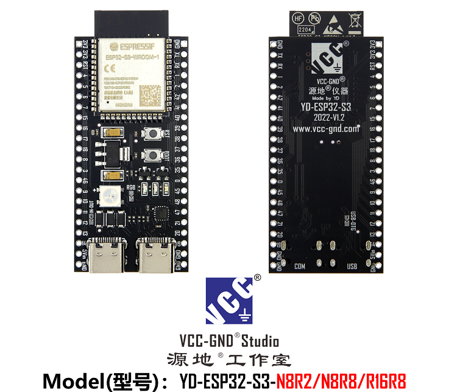
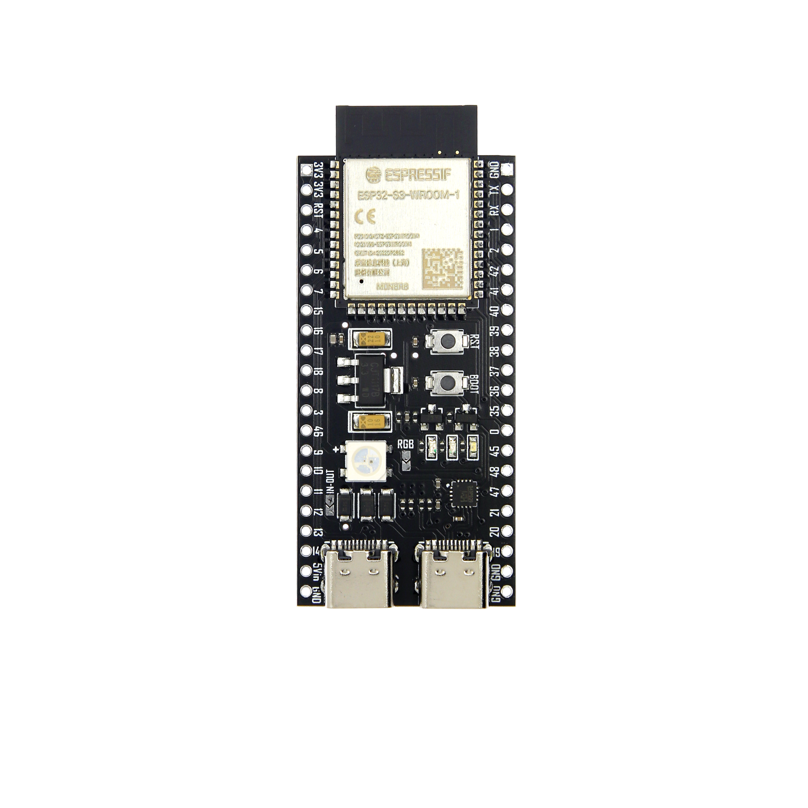
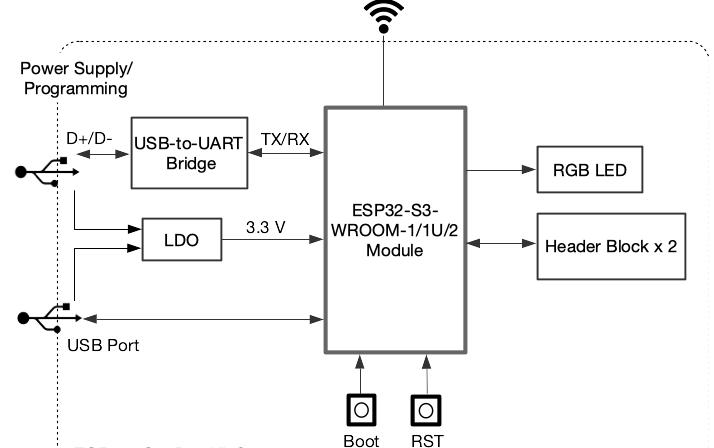
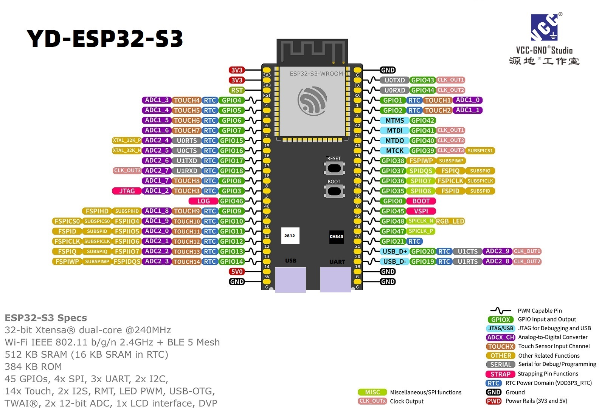
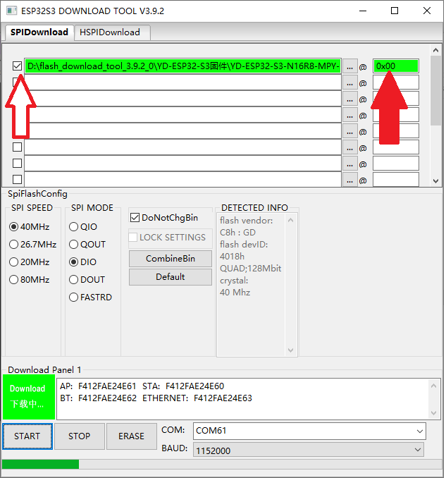

# YD-ESP32-S3 Core Board 

###### Introduction:

The YD-ESP32-S3 core board was designed by VCC-GND Studio. Visit www.vcc-gnd.com for purchasing information. It is based on the ESP32-S3 and can be used to prototype IoT applications or in production projects. It has two USB ports: one connected to the hardware USB-to-serial bridge (CH343P by WCH) and one connected directly to the ESP32-S3.

This guide will help you get started with the YD-ESP32-S3 and provides detailed information about the development board.

The YD-ESP32-S3 is an entry-level development board featuring the ESP32-S3-WROOM-1 module with Wi-Fi and Bluetooth® LE.

Most module pins are brought out to headers on both sides of the board. Developers can connect a variety of peripherals with jumper wires or use the board with a breadboard.

1. This is a minimal ESP32-S3 core board using an Espressif ESP32-S3 module.
2. A dedicated LDO circuit supplies the wireless functions, providing sufficient current and power.
3. It includes a WS2812 RGB LED (note that it is not driven directly by a GPIO).
4. The RST button resets the board. Pressing the Boot button while pressing RST enters bootloader mode; after reset, Boot can also be used as a user button on GPIO0.
5. The board has two Type-C ports: one connected directly to USB (GPIO19 and GPIO20), and one connected to the USB-to-serial bridge. The board includes a CH343 USB-to-serial chip.

###### Hardware Overview:

| Main Component                           | Description                                                  |
| :--------------------------------------- | ------------------------------------------------------------ |
| ESP32-S3-WROOM-1                         | A general-purpose Wi-Fi and Bluetooth Low Energy MCU module with a rich set of peripheral interfaces and powerful neural-network and signal-processing capabilities, designed for AI and AIoT applications. It uses a PCB antenna. |
| 5 V to 3.3 V LDO                         | Power converter with a 5 V input, 3.3 V output, and 1 A current rating. |
| Pin Headers                              | All available GPIO pins (except the flash SPI bus) are brought out to the board headers. |
| USB-to-UART Port                         | Type-C USB port for powering the board, flashing firmware, or communicating with the chip through the onboard USB-to-UART bridge. |
| Boot Button                              | Download button. Hold **Boot** and press **Reset** to enter firmware download mode and flash firmware over the serial port. After startup, it can be used as a regular input button on GPIO0. |
| Reset Button                             | Resets the board.                                             |
| USB Port                                 | ESP32-S3 USB OTG port supporting the full-speed USB 1.1 standard. It can power the board, flash firmware, communicate over USB, and be used for JTAG debugging. |
| USB-to-UART Bridge                       | CH343P chip by WCH. Website: http://www.wch-ic.com/ Driver: http://www.wch-ic.com/products/CH343.html? |
| RGB LED                                  | Addressable WS2812 RGB LED driven by GPIO48.                 |
| PWR LED                                  | Power indicator that lights when the board is powered. It cannot be controlled by software. |
| TX LED                                   | LED on the ESP32-S3 UART TXD line. It blinks when serial data is transmitted. GPIO43 can be used as a GPIO if the serial function is not needed. |
| RX LED                                   | LED on the ESP32-S3 UART RXD line. It blinks when serial data is received. GPIO44 can be used as a GPIO if the serial function is not needed. |

###### Note:

On boards in the ESP32-S3-WROOM-1 series that use 8-line SPI flash/PSRAM, GPIO35, GPIO36, and GPIO37 are used for communication between the ESP32-S3 chip and the SPI flash/PSRAM. They are not available for external use.

###### Getting Started with Application Development:
Before powering on the board, make sure it is in good condition.

###### Block Diagram:
The main components of the YD-ESP32-S3 and their connections are shown below:

###### Power Options:
Power the development board using any one of the following three methods:

Power through the USB-to-UART port or the ESP32-S3 USB port (either one, or both at the same time). This is the default and recommended method.

Power through the 5V and G (GND) header pins.

Power through the 3V3 and G (GND) header pins.

###### Pin Headers:
The following tables list the names and functions of the headers (P1 and P2) on both sides of the board. The pin names are shown in the YD-ESP32-S3 front-view image, and the pin numbers match the development board schematic (PDF).

###### P1

| Number | Name | Type  | Function                                                     |
| ---- | ---- | ----- | ------------------------------------------------------------ |
| 1    | 3V3  | P     | 3.3 V power                                                  |
| 2    | 3V3  | P     | 3.3 V power                                                  |
| 3    | RST  | I     | EN                                                           |
| 4    | 4    | I/O/T | RTC_GPIO4, GPIO4, TOUCH4, ADC1_CH3                           |
| 5    | 5    | I/O/T | RTC_GPIO5, GPIO5, TOUCH5, ADC1_CH4                           |
| 6    | 6    | I/O/T | RTC_GPIO6, GPIO6, TOUCH6, ADC1_CH5                           |
| 7    | 7    | I/O/T | RTC_GPIO7, GPIO7, TOUCH7, ADC1_CH6                           |
| 8    | 15   | I/O/T | RTC_GPIO15, GPIO15, U0RTS, ADC2_CH4, XTAL_32K_P              |
| 9    | 16   | I/O/T | RTC_GPIO16, GPIO16, U0CTS, ADC2_CH5, XTAL_32K_N              |
| 10   | 17   | I/O/T | RTC_GPIO17, GPIO17, U1TXD, ADC2_CH6                          |
| 11   | 18   | I/O/T | RTC_GPIO18, GPIO18, U1RXD, ADC2_CH7, CLK_OUT3                |
| 12   | 8    | I/O/T | RTC_GPIO8, GPIO8, TOUCH8, ADC1_CH7, SUBSPICS1                |
| 13   | 3    | I/O/T | RTC_GPIO3, GPIO3, TOUCH3, ADC1_CH2                           |
| 14   | 46   | I/O/T | GPIO46                                                       |
| 15   | 9    | I/O/T | RTC_GPIO9, GPIO9, TOUCH9, ADC1_CH8, FSPIHD, SUBSPIHD         |
| 16   | 10   | I/O/T | RTC_GPIO10, GPIO10, TOUCH10, ADC1_CH9, FSPICS0, FSPIIO4, SUBSPICS0 |
| 17   | 11   | I/O/T | RTC_GPIO11, GPIO11, TOUCH11, ADC2_CH0, FSPID, FSPIIO5, SUBSPID |
| 18   | 12   | I/O/T | RTC_GPIO12, GPIO12, TOUCH12, ADC2_CH1, FSPICLK, FSPIIO6, SUBSPICLK |
| 19   | 13   | I/O/T | RTC_GPIO13, GPIO13, TOUCH13, ADC2_CH2, FSPIQ, FSPIIO7, SUBSPIQ |
| 20   | 14   | I/O/T | RTC_GPIO14, GPIO14, TOUCH14, ADC2_CH3, FSPIWP, FSPIDQS, SUBSPIWP |
| 21   | 5V   | P     | 5 V power                                                    |
| 22   | G    | G     | Ground                                                       |

###### P2

| Number | Name | Type  | Function                                              |
| ---- | ---- | ----- | ----------------------------------------------------- |
| 1    | G    | G     | Ground                                                |
| 2    | TX   | I/O/T | U0TXD, GPIO43, CLK_OUT1                               |
| 3    | RX   | I/O/T | U0RXD, GPIO44, CLK_OUT2                               |
| 4    | 1    | I/O/T | RTC_GPIO1, GPIO1, TOUCH1, ADC1_CH0                    |
| 5    | 2    | I/O/T | RTC_GPIO2, GPIO2, TOUCH2, ADC1_CH1                    |
| 6    | 42   | I/O/T | MTMS, GPIO42                                          |
| 7    | 41   | I/O/T | MTDI, GPIO41, CLK_OUT1                                |
| 8    | 40   | I/O/T | MTDO, GPIO40, CLK_OUT2                                |
| 9    | 39   | I/O/T | MTCK, GPIO39, CLK_OUT3, SUBSPICS1                     |
| 10   | 38   | I/O/T | GPIO38, FSPIWP, SUBSPIWP                              |
| 11   | 37   | I/O/T | SPIDQS, GPIO37, FSPIQ, SUBSPIQ                        |
| 12   | 36   | I/O/T | SPIIO7, GPIO36, FSPICLK, SUBSPICLK                    |
| 13   | 35   | I/O/T | SPIIO6, GPIO35, FSPID, SUBSPID                        |
| 14   | 0    | I/O/T | RTC_GPIO0, GPIO0                                      |
| 15   | 45   | I/O/T | GPIO45                                                |
| 16   | 48   | I/O/T | GPIO48, SPICLK_N, SUBSPICLK_N_DIFF, RGB LED           |
| 17   | 47   | I/O/T | GPIO47, SPICLK_P, SUBSPICLK_P_DIFF                    |
| 18   | 21   | I/O/T | RTC_GPIO21, GPIO21                                    |
| 19   | 20   | I/O/T | RTC_GPIO20, GPIO20, U1CTS, ADC2_CH9, CLK_OUT1, USB_D+ |
| 20   | 19   | I/O/T | RTC_GPIO19, GPIO19, U1RTS, ADC2_CH8, CLK_OUT2, USB_D- |
| 21   | G    | G     | Ground                                                |
| 22   | G    | G     | Ground                                                |

P: Power; I: Input; O: Output; T: Can be configured as high-impedance.

###### Pinout:

###### Official CH340 Driver Links:

http://www.wch-ic.com/products/CH340.html?        ENGLISH

https://www.wch.cn/products/CH340.html?from=list     Chinese

MicroPython Firmware Download:

The ESP32-S3 flash and erase utility, `flash_download_tool_3.9.2_0`, is available for Windows.
Note: No installation is required; extract the archive and run the tool. Click the gear icon, select ESP32-S3, `develop`, and `USART`, then follow the screenshots. Make sure the starting address is `0x00` and check the box beside it. If flashing fails, the USB-to-serial driver may not be installed correctly; resolve the driver issue first.

Note:

Do not use the ESP32 flasher built into Thonny to flash MicroPython firmware onto the ESP32-S3. Thonny's flasher is for the ESP32, not the ESP32-S3; it uses the ESP32 address `0x1000` rather than the S3 address `0x00`. Also, the MicroPython firmware with PSRAM available from the official download page will not work correctly after flashing. Instead, use Espressif's official flash tool: select ESP32-S3 and serial download (USART), connect the board's USB port that appears as a COM port, and select the corresponding firmware (the version customized by VCC-GND Studio). Set the start address to `0x00`, check the box beside the firmware selection, and erase the flash before downloading if possible.
The firmware is linked in the folder beginning with `1-`, and the firmware download utility is linked in the folder beginning with `2-`. Before use, it is recommended that you update the CH343 USB-to-serial hardware driver. See the notes in the folder beginning with `0-`. In Device Manager, confirm that a COM port with `CH343` in its name appears.

To download Tasmota firmware, use the official Tasmota web flasher:

https://tasmota.github.io/docs/

You can use Espressif's download tool to flash your own firmware files.

https://www.espressif.com.cn/en/home

This section contains resources for the ESP32-S3. Basic resources include the CH343 hardware serial driver, the VCC-GND Studio version of MicroPython firmware, firmware download software, a MicroPython IDE, schematics, board dimensions, and more: http://124.222.62.86/yd-data/YD-ESP32-S3/

For programming in C with the official ESP-IDF, see the detailed documentation and API reference: https://docs.espressif.com/projects/esp-idf/en/latest/esp32s3/get-started/index.html

For programming with Arduino, see: https://docs.espressif.com/projects/arduino-esp32/en/latest/getting_started.html#about-arduino-esp32

For programming with MicroPython, see: https://docs.micropython.org/en/latest/esp32/quickref.html (The ESP32 quick reference is sufficient.)
###### Counterfeit and Poor-Quality Clones:

Many counterfeit and low-quality clones of VCC-GND Studio (YD) development boards are sold, especially in Shenzhen's Huaqiangbei market. A common practice is to sand down one of our boards, photograph it, and copy its design, leaving the resulting products with numerous risks. The following are some of the risks of buying a cloned board, using the YD-ESP32 (ESP32/S2/S3/C3) series as an example:

1. To increase profits, clone manufacturers often use refurbished or unofficial components, substituting cheaper parts in the same package without regard for suitability.

2. The WS2812 LED signal is not soldered, so the LED cannot be used. This suggests that the board is not inspected, in order to save effort and reduce costs.

3. Cloned boards are not inspected before shipping. They are packaged as soon as they leave the production line, skipping quality-control steps to reduce costs.

4. Because the board is copied from photographs, many silkscreen labels are copied incorrectly, which can mislead consumers and even confuse the manufacturers themselves.

5. Clones are based on the early 2022 version 1.2, while the genuine board is version 1.4. Clones do not support newer features because their design is not updated.

6. Clones use low-cost third-party modules that have not undergone impedance matching. Wi-Fi and Bluetooth may therefore consume more power, have poor signal quality, and cause the board to freeze.

7. Since clone manufacturers may not have access to the dedicated LDO used on our boards, they may choose an unsuitable part such as the low-cost 1117. Its high dropout voltage can cause the board to freeze and degrade signal quality.

8. Clones may use low-cost diodes with a high forward-voltage drop (over 0.7 V), leaving insufficient voltage for the downstream LDO and further increasing power consumption, freezing, and poor signal quality.

9. Clone manufacturers do not provide basic technical support. Even their documentation is copied from our older materials; they do not bother to find the latest documentation. After a sale, they provide no further support.

10. Cloned boards may fail to start and enter the bootloader directly, making them unusable. The clone manufacturers may not understand the cause.

11. Since clone manufacturers copy the board from photographs, they do not have a schematic. Users may not know how to use the board, and the manufacturers may not know either, making the product difficult to use.

Some counterfeiters print labels such as YD-ESP32 on cloned boards to mislead consumers. Others even print our official website, WWW.VCC-GND.COM, on counterfeit products. These actions may violate applicable laws, and we reserve the right to pursue them. We urge consumers not to risk the issues above or waste time and effort to save a small amount of money. Support VCC-GND Studio and genuine products; look for the VCC-GND trademark when purchasing.

###### Assigning Functions to Pins Through the Internal GPIO Matrix:

ESP32-series documentation lists peripheral communication interfaces such as I2C, I2S, UART, and SPI, but the pinout diagrams may not assign them to specific pins. This is because these peripheral interfaces can be mapped to GPIO pins as needed through the GPIO matrix, so a diagram does not need to show a fixed pin assignment. Any suitable GPIO can be assigned to provide the pins required by these interfaces.

